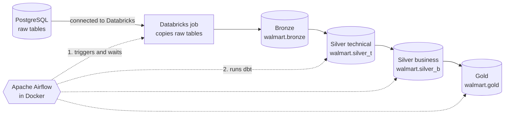
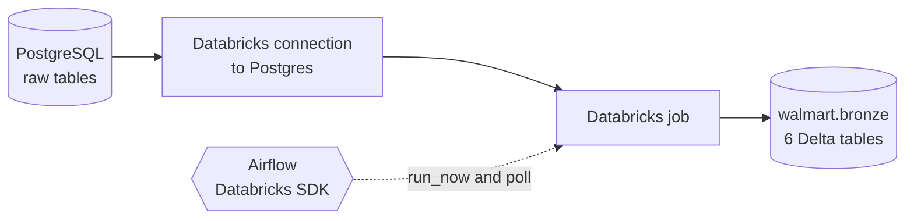
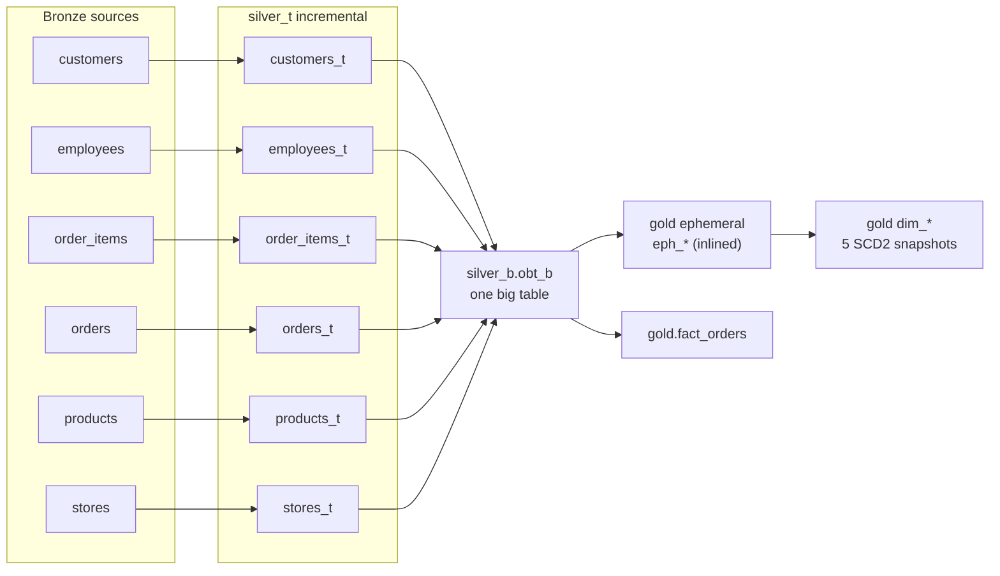
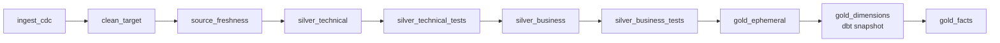
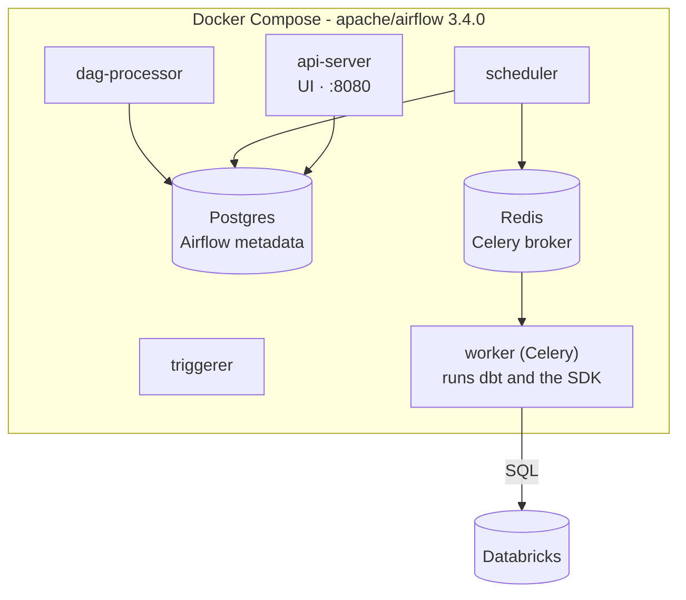

# Walmart Lakehouse Pipeline

An end-to-end, orchestrated ELT project built on the **medallion architecture**.
Raw retail tables live in **PostgreSQL**; **Databricks** is connected to Postgres and copies them into a **bronze** layer;
**dbt** transforms them through **silver** and **gold** (incremental models, a one-big-table, SCD Type 2 dimensions and a fact table);
**Apache Airflow**, running in **Docker**, orchestrates the whole flow.


## Architecture



| Layer | Schema | Contents | Built by |
|---|---|---|---|
| Source | PostgreSQL | Raw tables: customers, orders, order_items, products, employees, stores | Operational database |
| Bronze | `walmart.bronze` | Raw tables copied from Postgres into Databricks | Databricks job |
| Silver technical | `walmart.silver_t` | Same entities, de-duplicated and incrementally merged, plus `processed_at` | dbt incremental models |
| Silver business | `walmart.silver_b` | `obt_b`: all silver tables joined into one denormalised table (Jinja-generated) | dbt table model |
| Gold | `walmart.gold` | `fact_orders` and `dim_customers/employees/orders/products/stores` (SCD Type 2) | dbt table + snapshots |

## How it works, tool by tool

### 1. PostgreSQL: the source

The raw operational tables (customers, orders, order_items, products, employees, stores) were first created in PostgreSQL.
Every table carries `created_timestamp`, `updated_timestamp` and `is_active`, which the later layers use to detect changes.

### 2. Databricks: ingestion into bronze

Databricks was connected to the PostgreSQL database, and a Databricks job dumps the raw tables into the bronze schema.
The same job runs on every pipeline execution, so new and changed rows keep flowing into bronze.



### 3. dbt: transformations

dbt reads bronze as *sources* and builds silver and gold on the Databricks SQL warehouse.



- **Incremental `MERGE` in silver:** each model filters on `updated_timestamp > MAX(updated_timestamp)` and merges on a `unique_key`, so only changed rows are processed.
- **Metadata-driven OBT:** `obt_b` builds its `SELECT` and `LEFT JOIN` chain from a Jinja list, so adding a table is a one-entry change.
- **SCD Type 2 dimensions:** dbt snapshots with the `timestamp` strategy keep history (`dbt_valid_from` / `dbt_valid_to`).
- **Clean schema names:** `generate_schema_name` is overridden so models land in `silver_t`, `silver_b` and `gold`.
- **Tests:** `not_null` / `unique` tests on key columns, run between layers as quality gates.

### 4. Airflow: orchestration

The `orchestrate` DAG runs ten tasks in order. If a task fails, everything after it is skipped.



- `ingest_cdc` starts the Databricks job through the Databricks SDK and polls until it finishes, so transformations never start on stale data.
- The remaining tasks are shell tasks that run `dbt` inside the mounted dbt project.

### 5. Docker: runtime

Airflow runs as a Docker Compose stack. The `dags/`, `config/`, `plugins/`, `logs/` and `walmart_project/` folders are mounted into the containers.



## Tech stack

PostgreSQL (source) · Databricks (Delta Lake, SQL warehouse, Jobs) · dbt Core + `dbt-databricks` · Apache Airflow 3.4 (Celery executor) · Docker Compose · Python 3.12 · Jinja

## Repository structure

```text
airflow_dbt_project/
├── docker-compose.yaml        # Airflow stack (api-server, scheduler, dag-processor, worker, triggerer, Postgres, Redis)
├── .env.example               # template for .env  (copy and fill in)
├── dags/
│   └── orchestrate.py         # the pipeline DAG
├── config/                    # airflow.cfg (generated locally, git-ignored)
├── plugins/
└── walmart_project/           # dbt project (mounted into the containers)
    ├── dbt_project.yml
    ├── profiles.yml.example   # template for profiles.yml (copy and fill in)
    ├── macros/custom_schema.sql        # clean schema names (silver_t, silver_b, gold)
    ├── models/
    │   ├── sources/sources.yml         # bronze sources
    │   ├── Silver_t/                   # incremental models + tests
    │   ├── silver_b/obt_b.sql          # one big table
    │   └── gold/ { ephemeral/, fact/ } # staging + fact table
    ├── snapshots/                      # SCD2 dimensions
    └── tests/test_obt.sql
```

## Getting started

### Prerequisites
- Docker Desktop (Compose v2)
- A PostgreSQL database holding the raw tables
- A Databricks workspace with a SQL warehouse, a catalog named `walmart`, a connection to the Postgres database, and a Databricks job that copies the raw tables into `walmart.bronze`
- A Databricks personal access token

### 1. Configure secrets (both files are git-ignored)

```bash
cp .env.example .env
cp walmart_project/profiles.yml.example walmart_project/profiles.yml
```

Edit both files with your Databricks host, token and SQL warehouse `http_path`.
In `dags/orchestrate.py`, set the `job_id` of your own Databricks ingestion job.

### 2. Start Airflow

```bash
docker compose up -d
```

The first start installs `databricks-sdk` and `dbt-databricks` into the containers, so it takes a few minutes.
Open <http://localhost:8080> (default local login `airflow` / `airflow`), unpause the `orchestrate` DAG and trigger it.

### 3. Useful commands

```bash
docker compose ps
docker compose exec airflow-scheduler airflow dags list
docker compose exec airflow-scheduler airflow dags list-import-errors
docker compose down
```

### Run dbt on its own (optional)

```bash
cd walmart_project
dbt debug
dbt run --full-refresh     # first load / after schema changes
dbt run                    # incremental runs
dbt test
dbt snapshot
```
