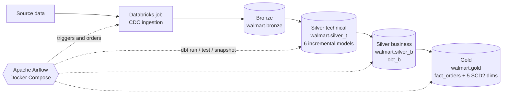
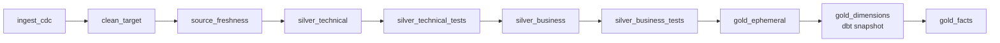

# Walmart Lakehouse Pipeline

An end-to-end, orchestrated ELT project built on the **medallion architecture**.
Raw retail data lands in a Databricks **bronze** layer; **dbt** transforms it through **silver** and **gold**
(incremental models, a one-big-table, SCD Type 2 dimensions and a fact table); **Apache Airflow**, running in **Docker**,
orchestrates the whole flow.


> A detailed walkthrough (architecture diagrams, line-by-line explanations, design decisions and interview Q&A)
> is in [`docs/PROJECT_GUIDE.html`](docs/PROJECT_GUIDE.html). Download or clone the repo and open it in a browser.

## Architecture



| Layer | Schema | Contents | Built by |
|---|---|---|---|
| Bronze | `walmart.bronze` | Raw tables: customers, orders, order_items, products, employees, stores | Databricks job |
| Silver technical | `walmart.silver_t` | Same entities, de-duplicated and incrementally merged, plus `processed_at` | dbt incremental models |
| Silver business | `walmart.silver_b` | `obt_b`: all silver tables joined into one denormalised table (Jinja-generated) | dbt table model |
| Gold | `walmart.gold` | `fact_orders` and `dim_customers/employees/orders/products/stores` (SCD Type 2) | dbt table + snapshots |

## Orchestration (Airflow DAG `orchestrate`)



- `ingest_cdc` starts a Databricks job through the Databricks SDK and polls until it finishes, so transformations never start on stale data.
- Tests run between layers as quality gates; a failure stops the DAG.

## Tech stack

Databricks (Delta Lake, SQL warehouse) · dbt Core + `dbt-databricks` · Apache Airflow 3.4 (Celery executor) · Docker Compose · PostgreSQL · Redis · Python 3.12 · Jinja

## Repository structure

```text
airflow_dbt_project/
├── docker-compose.yaml        # Airflow stack (api-server, scheduler, dag-processor, worker, triggerer, Postgres, Redis)
├── .env.example               # template for .env  (copy and fill in)
├── dags/
│   └── orchestrate.py         # the pipeline DAG
├── config/                    # airflow.cfg (generated locally, git-ignored)
├── plugins/
├── docs/
│   └── PROJECT_GUIDE.html     # full project guide
└── walmart_project/           # dbt project (mounted into the containers)
    ├── dbt_project.yml
    ├── profiles.yml.example   # template for profiles.yml (copy and fill in)
    ├── macros/custom_schema.sql        # clean schema names (silver_t, silver_b, gold)
    ├── models/
    │   ├── sources/sources.yml         # bronze sources
    │   ├── Silver_t/                   # incremental models + tests
    │   ├── silver_b/obt_b.sql          # one big table
    │   └── gold/ { ephemeral/, fact/ } # staging + fact table
    ├── snapshots/                      # SCD2 dimensions
    └── tests/test_obt.sql
```

## Getting started

### Prerequisites
- Docker Desktop (Compose v2)
- A Databricks workspace with a SQL warehouse, a catalog named `walmart`, the six bronze tables in `walmart.bronze`, and a Databricks job that loads them
- A Databricks personal access token

### 1. Configure secrets (both files are git-ignored)

```bash
cp .env.example .env
cp walmart_project/profiles.yml.example walmart_project/profiles.yml
```

Edit both files with your Databricks host, token and SQL warehouse `http_path`.
In `dags/orchestrate.py`, set the `job_id` of your own Databricks ingestion job.

### 2. Start Airflow

```bash
docker compose up -d
```

The first start installs `databricks-sdk` and `dbt-databricks` into the containers, so it takes a few minutes.
Open <http://localhost:8080> (default local login `airflow` / `airflow`), unpause the `orchestrate` DAG and trigger it.

### 3. Useful commands

```bash
docker compose ps
docker compose exec airflow-scheduler airflow dags list
docker compose exec airflow-scheduler airflow dags list-import-errors
docker compose down
```

### Run dbt on its own (optional)

```bash
cd walmart_project
dbt debug
dbt run --full-refresh     # first load / after schema changes
dbt run                    # incremental runs
dbt test
dbt snapshot
```

## Key design decisions

- **Incremental `MERGE` in silver.** Each model filters on `updated_timestamp > MAX(updated_timestamp)` and merges on a `unique_key`, so only changed rows are processed.
- **Metadata-driven OBT.** `obt_b` builds its `SELECT` and `LEFT JOIN` chain from a Jinja list, so adding a table is a one-entry change.
- **SCD Type 2 with dbt snapshots.** Dimensions keep history using the `timestamp` strategy.
- **Clean schema names.** `generate_schema_name` is overridden so models land in `silver_t`, `silver_b` and `gold` instead of `dbt_schema_<name>`.
- **No secrets in code.** The Databricks token is read from environment variables; `.env` and `profiles.yml` are never committed.

## Known limitations and roadmap

- `obt_b` joins employees on `store_id`, which multiplies order rows; the employees join should be removed or aggregated.
- `obt_b` uses hard-coded table names instead of `ref()`; ordering currently relies on Airflow.
- `dim_orders` is keyed on `order_id` while its source has one row per order item.
- Add `loaded_at_field` to the sources so `dbt source freshness` measures something, and add more data tests.
- Build a custom Airflow image (instead of installing pip packages at start-up), add a schedule, retries and failure alerts, and separate dev and prod environments with CI.

## License

Add a license of your choice (for example MIT) before making the repository public.
